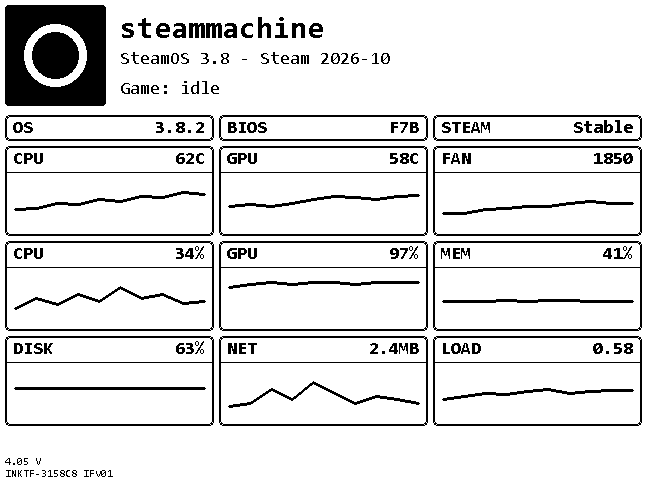
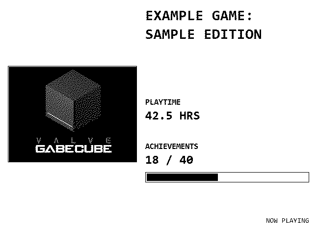
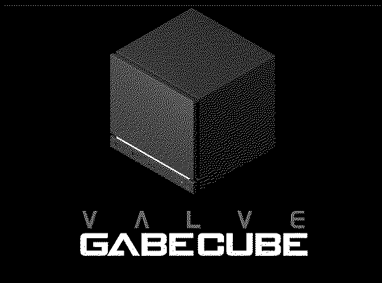

# Inkterface Gabe Edition

Live Steam Machine stats and full-screen Gabe artwork on a 648×480 monochrome e-paper
display. A customization of Valve's Inkterface with a Steam-aware **Automatic** mode,
a **Now Playing** screen, a Gabe portrait slideshow, the GabeCube screen, and a battery
friendly offline sleep with a wake button.

| Statistics | Now Playing |
|:---:|:---:|
|  |  |

- [Views](#views)
- [Features](#features)
- [Required Hardware](#required-hardware)
- [Assembly](#assembly)
- [One-Click Installation](#one-click-installation)
- [Installation (manual)](#installation-manual)
- [Usage](#usage)
- [Power saving and battery](#power-saving-and-battery)
- [Building from source](#building-from-source)
- [Troubleshooting](#troubleshooting)
- [Credits and license](#credits-and-license)

> **Note on the images:** Gabe portraits and GabeCube are decoded directly from the
> firmware bitmaps and show exactly what the panel draws. Statistics and Now Playing are
> illustrative renderings with sample data (`scripts/render_previews.py`); real content
> depends on your host and game.


## Views

### Statistics
Logo, host name, OS/BIOS/Steam versions and nine configurable sparkline panels
(temperatures, fan, CPU/GPU/memory usage, disk usage, network throughput, system load).
Every readout can be changed in the configuration app.


### Now Playing
Game cover art, title, playtime and achievements (when your Steam profile is public).
Local Steam artwork is preferred, with an online fallback.


### Gabe portrait slideshow
Five full-screen portraits, cropped to fill the panel without stretching. A different
image is picked on each refresh.

| | | |
|:---:|:---:|:---:|
|  |  |  |
|  |  | |

### GabeCube
Shown when Steam is closed or the host is off. The panel only refreshes when the mode
changes.




## Features

- Display modes selectable from the SteamOS app: **Statistics**, **Gabe portrait**,
  **GabeCube**, **Now Playing**, **Automatic**.
- **Automatic** mode:
  - Game running: Now Playing alternating with Statistics every 30 seconds.
  - Steam open, no game: portrait slideshow.
  - Steam closed or host unreachable (BLE lost for 60 s): GabeCube.
- Refresh only when the shown content changes.
- Offline deep sleep with **SW38** as wake button (Feather V2).
- Battery voltage monitoring with a low-battery warning at 3.3 V (Feather V2).
- Runs as a lightweight user service on SteamOS; the config app is only needed to
  select a panel or change settings.
- Now Playing and Automatic game screens require the matching Feather V2 firmware from
  this repository.


## Required Hardware

* 1 x Adafruit ESP32 Feather
    * [V1 board (ESP32-S3 Feather w/ 2MB PSRAM), as shown in the assembly video](https://www.adafruit.com/product/5477)
    * [V2 board (ESP32 Feather V2)](https://www.adafruit.com/product/5400)
    * Both work but have different pinouts. Check for the "V2" silkscreen on your board
      and choose the matching pinout sheet and firmware environment. The Gabe Edition
      power-saving features (SW38 wake, battery monitoring) target the **V2**.
* 1 x [Adafruit eInk Breakout Friend](https://www.adafruit.com/product/4224)
* 1 x [Adafruit 5.83" Monochrome eInk Panel](https://www.adafruit.com/product/6397)
* 1 x [LP803860 Battery](https://www.adafruit.com/product/2011)
* 13 x M2.5 x 5mm Pan Head Machine Screws
    * [McMaster](https://www.mcmaster.com/92000A103/)
    * [Amazon](https://www.amazon.com/dp/B0GC58C2V5)
* 4 x [1/4" x 1/4" x 3/16" Stepped Magnet SB443-OUT](https://www.kjmagnetics.com/sb443-out-neodymium-stepped-block-magnet)


## Assembly

Check out the video `./docs/Inkterface Assembly.mp4` for a quick assembly tutorial,
or the PDF version `./docs/Inkterface Assembly.pdf`. An iFixit guide is also
[available](https://de.ifixit.com/Anleitung/Anleitung+zum+Zusammenbau+des+Steam+Machine+Inkterface/226061).

**_Warning: The screws will thread themselves into the plastic, but be VERY gentle
as it is easy to strip the plastic away and you may need to re-print parts!_**

1. Print parts from the `./cad` folder.
    * Individual parts are separate STEP files; a combined file for a Stratasys F370
      build plate is provided as `Inkterface - Print Plate.step`.
2. Attach the ESP32 Feather and eInk Breakout to the board plate layer using 4x screws.
3. Solder wires between the pins of the two boards.
    * MOSI/MISO/SCK/GND connect directly.
    * 3V3 from the feather connects to VIN on the breakout (the breakout's 3V3 pin is an output).
    * **_V1_** feather -> breakout: PIN 6 -> ENA, PIN 9 -> BUSY, PIN 10 -> RST,
      PIN 11 -> SRCS, PIN 12 -> D/C, PIN 13 -> ECS
    * **_V2_** feather -> breakout: PIN 32 -> ENA, PIN 15 -> BUSY, PIN 33 -> RST,
      PIN 27 -> SRCS, PIN 12 -> D/C, PIN 13 -> ECS
    * Both versions use pins in the same physical positions, but they are different
      logical pins in the firmware.
    * Wiring diagrams: `docs/Feather V1 Wiring Diagram.png`, `docs/Feather V2 Wiring Diagram.png`.
4. Place the e-ink panel into the recess in the faceplate.
5. Fit the two midplates in.
6. Place the 4 magnets into the corner recesses of the midplates (orientation doesn't matter).
7. Place the board plate over the midplates, aligning magnets and screw holes.
8. Fasten the board plate with 8x screws along the edges.
9. Connect the e-ink panel to the breakout board. The panel flex is fragile; do not bend or fold it.
10. Place the battery in the recess, tucking its wire under the board plate and up into
    the clearance hole beside the feather.
11. Insert and fasten the battery retainer/cover.
12. Plug the battery connector into the feather.

The unit magnets onto the front of the Steam Machine. Flash the firmware next.


## One-Click Installation

Installs the firmware (USB) and the host app. Both scripts download prebuilt files from
the latest [GitHub Release](https://github.com/JoppeJoppinger/Inkterface_GabeEdition/releases),
verify SHA-256 checksums, auto-detect the Feather (V1/V2) and its serial port, and flash it
with a bundled-on-demand `esptool`. No Python or PlatformIO is required.

**Windows** (flashes the Feather connected to the PC, installs the app on the Steam Machine
over SSH): double-click `install.bat`, or in PowerShell:
```
.\install.ps1 -SteamHost steammachine -SteamUser deck
```
Prerequisite on the Steam Machine: SSH enabled (Desktop Mode: set a password with
`passwd`, then `sudo systemctl enable --now sshd`). Disable SSH again afterwards if you like.

**Linux / SteamOS** (flashes the Feather connected to this machine, installs the app locally):
```
chmod +x install.sh
./install.sh
```
You may need serial permission first: `sudo usermod -aG dialout $USER`, then log in again.

Common options (`-Name` on Windows, `--name` on Linux): `board v1|v2`, `port`, `version`,
`local DIR` (use files from a folder instead of downloading), `skip-firmware`, `skip-app`,
`dry-run`. Windows additionally has `-SteamHost`, `-SteamUser`, `-SshKey`.

Releases are built by `.github/workflows/release.yml` when a `v*` tag is pushed. Until a
release exists, build the files yourself and use `local`. `scripts/merge_firmware.py`
creates the single flashable image (`inkterface-firmware-featherv2.bin`).

After the installer: enable Bluetooth (do not pair the Inkterface) and run the app once in
Desktop Mode to select your panel and display mode.

## Installation (manual)

Installation has two parts: flashing the **firmware** onto the Feather (from a PC) and
installing the **host app** on the Steam Machine (SteamOS).

### 1. Flash the firmware (PC)

**Requirements:** USB data cable, the assembled Feather, [Python 3](https://www.python.org)
and [PlatformIO](https://platformio.org).

1. Install PlatformIO: `pip install platformio`
2. Clone this repository:
   `git clone https://github.com/JoppeJoppinger/Inkterface_GabeEdition.git`
3. Connect the Feather via USB. If it is not detected, hold the **Boot/BOOT0** button
   while pressing **Reset** to enter the bootloader.
4. Find the serial port (Windows: Device Manager -> Ports, e.g. `COM5`; Linux:
   `/dev/ttyACM0` or `/dev/ttyUSB0`). On Linux your user needs serial permission
   (`sudo usermod -aG dialout $USER`, then log in again).
5. Build and upload from the `firmware` folder:
   ```
   cd firmware
   pio run -e featherv2 -t upload --upload-port <PORT>
   ```
   Use `-e featherv1` for the V1 board. On Windows, if `pio` is not on the PATH, use
   `python -m platformio run -e featherv2 -t upload --upload-port COM5`.
6. After the upload the display shows **"Waiting on connection"** and the panel
   advertises over BLE as `INKTF-XXXXXX`.

### 2. Install the host app (SteamOS / Steam Machine)

You need the AppImage `Inkterface.AppImage`. Build it yourself (see
[Building from source](#building-from-source)) or copy a prebuilt one.

1. Copy the AppImage to the Steam Machine (USB stick, `scp`, or file sharing), e.g. to
   `~/Applications/Inkterface.AppImage`.
2. Make it executable:
   `chmod +x ~/Applications/Inkterface.AppImage`
3. Enable Bluetooth in SteamOS settings. **Do not pair** the Inkterface in the Bluetooth
   settings; the app talks to it directly over BLE.
4. Switch to **Desktop Mode** and launch the AppImage (double click, or in a terminal:
   `~/Applications/Inkterface.AppImage`). Optionally add it as a non-Steam game.
5. Wait for the app to discover your panel and select it. The name must match the one
   shown by the panel (`INKTF-` plus part of its BLE MAC address). If the panel does not
   appear, press **Reset** on the Feather and check that Bluetooth is on.
6. On the configure screen click the **service** button at the bottom right to install
   the background service.
   * It is installed as the user service `inkterface.service` and starts automatically
     at login. **Do not move or rename the AppImage afterwards**, or the service breaks
     (just run the app again to reinstall it).
   * The first connection can take 10-20 seconds while BLE discovery completes.
7. Choose the content in the **Display** menu and adjust the readouts by clicking them.
8. Close the configuration app. The service keeps running in the background.

Useful service commands (run on the Steam Machine):
```
systemctl --user status inkterface.service
systemctl --user restart inkterface.service
journalctl --user -u inkterface.service -f
```

### 3. Update

- **Firmware:** repeat step 1 with the new source.
- **Host app:** replace the AppImage at the same path, then
  `systemctl --user restart inkterface.service`.
- Keep firmware and app from the same version of this repository.


## Usage

1. Open the config app and pick the **Display** mode (Statistics, Gabe portrait,
   GabeCube, Automatic, Now Playing). The choice is saved and applied immediately with
   a full refresh.
2. Click any readout in the statistics view to change what it shows. You can add
   your own readouts: return a `QString` or `double` and call `registerCollector()`
   (see `include/panel-state.hpp`; examples in `SysStats`).
3. In **Automatic** mode the host decides from Steam's process state and game-session log.
   Achievement data is optional and may be unavailable for private profiles.


## Power saving and battery

- A connected panel stays awake at 80 MHz, even in GabeCube mode.
- If the host disconnects over BLE, the firmware shows GabeCube after 60 seconds, puts
  the display controller to sleep and enters ESP32 deep sleep.
- **Press SW38** (the button on the Feather V2, GPIO38) to wake. The panel advertises over
  BLE for 30 seconds and sleeps again if no host connects. While asleep it does not
  reconnect on its own; the Steam Machine app connects as soon as it discovers the panel.
- On wake the existing image is kept; the host restores the selected mode on reconnect.
- In deep sleep GPIO2 (NeoPixel/I2C power) is switched off. Battery voltage is sampled
  via the onboard GPIO35 divider; at 3.3 V a low-battery warning is shown and the panel
  sleeps until SW38 is pressed.
- The **Reset** button just restarts the firmware.
- Real battery life depends on the host staying connected; it has not been measured with
  an ammeter yet.


## Building from source

### Host app (AppImage)

With Qt installed you can open the CMake project in Qt Creator. For distributable builds
use the included `Containerfile`:

1. `podman build -t qt69-builder -f ./Containerfile`
2. `distrobox create --image qt69-builder --name qt69`
3. `distrobox enter qt69`
4. `./scripts/build.sh deploy`

The AppImage appears in `./dist-linux-x86_64`. The container uses an older Ubuntu and
Qt 6.9 so the AppImage runs on a wide range of modern systems. On Windows you can run
the same script inside WSL (`bash scripts/build.sh`).

### Firmware

See [Flash the firmware](#1-flash-the-firmware-pc). The `platformio.ini` contains the V1
and V2 feather environments; add your own for other boards.

### Preview images

`python scripts/render_previews.py` regenerates `docs/previews/` (requires Pillow).


## Troubleshooting

| Problem | Fix |
|---|---|
| Panel not found in the app | Press Reset on the Feather, ensure Bluetooth is on, stay close during discovery. |
| Panel shows "Waiting on connection" | Service not running: `systemctl --user start inkterface.service`. |
| Display blank after offline period | Panel is in deep sleep; press SW38. |
| App does not start / crashes | Run it from a terminal and check the output; use `--headless` for the service. |
| Upload fails | Use a data USB cable, put the board in bootloader mode, check the `--upload-port`. |


## Credits and license

Based on Valve's Inkterface; original design docs are in `./design` (Lunacy files, an
open source alternative to Figma that works offline).

This project is licensed under the MIT License, see LICENSE.

This project depends on third-party software that is distributed under its own
licenses. Those licenses remain applicable to the respective components and
are not modified by this project's license.
